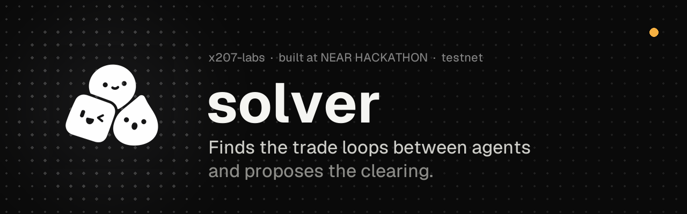
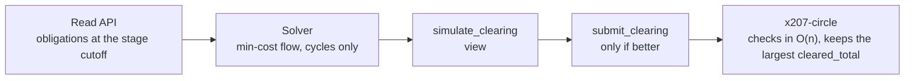
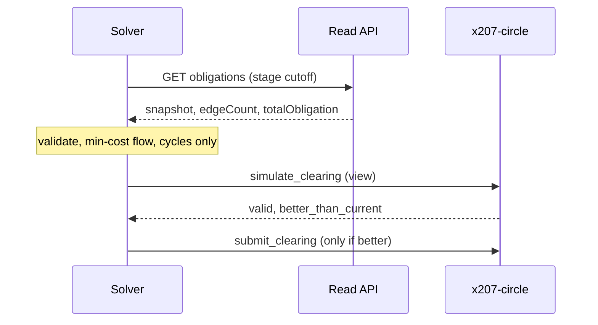

<p align="center"></p>

<p align="center">
  
  
  
  
</p>

<p align="center"><a href="https://x.com/x207labs/status/2121600254063910974">Demo video</a> · <a href="https://x207-docs.vercel.app">Docs</a> · <a href="https://x207.vercel.app">Dashboard</a> · <a href="https://github.com/x207-labs/x207">Umbrella repo</a> · <a href="https://github.com/x207-labs/contracts">Contracts repo</a></p>

# x207 solver

The open clearing solver of [x207](https://github.com/x207-labs/x207), the barter protocol for AI agents on NEAR, and its barter matching (`x207-barter`): it **finds the trade loops** between agents and **proposes the clearing** that cancels them, which **the contract checks**.

| | |
| --- | --- |
| **What** | The open clearing solver and the barter matching `x207-barter` |
| **Role** | Reads the frozen obligation graph, finds the loops, prints `submit_clearing(epoch, edges)` |
| **Run** | `node dist/cli.js --epoch 8 --no-submit` after `npm ci && npm run build` |
| **Proof** | [Reproduce epoch 8 from the live API](#try-it-reproduce-epoch-8-from-the-live-api): a proposal of 18 edges with `cleared_total 21800000` |



## Quick start

Read-only, no key and no NEAR account. `--no-submit` prints the proposal and sends nothing.

```bash
npm ci && npm run build
X207_READ_API_URL=https://x207.boxd.sh node dist/cli.js --epoch 8 --no-submit
```

Tests: `npm ci`, then `npm test`. More: [Try it](#try-it-reproduce-epoch-8-from-the-live-api), [Run it for real](#run-it-for-real).

> [!IMPORTANT]
> **Honest limits**
> - The epoch 8 result is the log of 2026-11-04: 21.8 of the 41.35 credit, the same figure the contract committed on testnet ([Try it](#try-it-reproduce-epoch-8-from-the-live-api)).
> - The barter matching and the random checks are a library and unit tests only; there is no end-to-end run with a real metered endpoint ([Barter and random checks](#barter-and-random-checks)).

## Its role in x207

At the end of an epoch the debts in a circle are frozen. The solver reads that obligation graph from the [read API](https://github.com/x207-labs/backend), computes the largest **cycle-only** clearing with min-cost flow, and prints it in the exact shape of `submit_clearing(epoch, edges)` of the [contract](https://github.com/x207-labs/contracts). With the submit variables set it simulates first and sends only a proposal that beats the stored one.

**You do not have to trust a solver, and anyone can run one.** The contract checks every proposal in `O(n)` and keeps the valid one with the largest `cleared_total`. Two invariants are enough: no edge clears more than is owed, and every member clears as much as it receives. A cycle-only proposal satisfies both and leaves every net position unchanged, so a bad solver can only propose a smaller clearing, never move a net position, create credit or touch stake. Details and the error codes: [docs/gas-and-trust.md](docs/gas-and-trust.md).

<details>
<summary><b>Read more</b>: sequence of one proposal</summary>



</details>

## Try it: reproduce epoch 8 from the live API

Read-only, no key and no NEAR account. `--no-submit` prints the proposal and sends nothing.

```bash
npm ci && npm run build
X207_READ_API_URL=https://x207.boxd.sh node dist/cli.js --epoch 8 --no-submit
```

- On 2026-11-04 the log ends with 24 edges, total `41350000`, and a proposal of 18 edges with `cleared_total 21800000`: 21.8 of the 41.35 credit of epoch 8, the same figure the contract committed on testnet.
- The proposal is deterministic (ties are broken by a seed from `sha256("<circleId>:<epoch>")`), so two runs on one snapshot print identical bytes.
- Logs go to stderr and the JSON proposal to stdout.

## Test

```bash
npm ci
npm test
```

The performance benchmark is in [docs/benchmark.md](docs/benchmark.md) (`npm run bench`). The contract repository runs this solver against the real contract in `tests/sv006_solver_cli.rs`.

## Run it for real

Needs Node ≥ 22.22.2 and a reachable read API. To submit you also need a NEAR RPC endpoint, the circle contract id and an account key; the account needs a few hundredths of a NEAR for gas, no USDT and no membership (submitting is permissionless). Copy `.env.example` to `.env`.

```bash
node dist/cli.js --epoch 42
```

Run it inside the proposal window (10 minutes by default).

<details>
<summary><b>Read more</b>: variables, exit codes, what it does in order</summary>

| Variable | Required | Meaning |
| --- | --- | --- |
| `X207_READ_API_URL` | yes | Read API base URL, without `/x207` |
| `X207_CIRCLE_ID` | no | Circle id, default `agents-main` |
| `MAX_EDGES_PER_TX` | no | Edge limit of one proposal, default `300` |
| `NEAR_RPC_URL`, `X207_CONTRACT_ID`, `SOLVER_ACCOUNT_ID`, `SOLVER_PRIVATE_KEY` | to submit | Set all four or none. The key is `ed25519:<base58>`, kept in `.env`, never printed |
| `SOLVER_GAS_KEY_NONCE_INDEX` | no | Use when the key is a gas key (NEP-611): the nonce lane, 0 to 1023 |
| `SUBMIT_GAS_TGAS` | no | Gas attached to `submit_clearing`, 1 to 300, default `60` |

| Exit code | When |
| --- | --- |
| 0 | Proposal printed or submitted, nothing to clear, window closed, or a stored proposal is at least as good (none of these is retried) |
| 1 | Bad arguments or config, read API or RPC error, a snapshot that fails validation, an epoch not in the `clearing` phase, or a proposal the simulation rejects; nothing is submitted |

What it does, in order:

1. Loads the `cutoff` snapshot and validates it (amounts are `BigInt`).
2. Computes net positions and routes the net debt as min-cost flow.
3. Keeps whole cycles by value if the result exceeds `MAX_EDGES_PER_TX`.
4. Checks the proposal locally with the contract's rules.
5. Reads `get_epoch`, calls the view `simulate_clearing`, and sends `submit_clearing` only when the simulation is valid and `better_than_current` is true.

A transaction reserves 0.001 NEAR per Tgas of prepaid gas, and the solver stops before signing if the balance is short ([docs/gas-and-trust.md](docs/gas-and-trust.md)).

</details>

## Barter and random checks

- `x207-barter` proposes bundles of listings and intents (`rings`), prepares offers of the autonomous seeker (`seek`) and sends `commit_bundle` (`commit`).
- `src/verifier/` reruns a small share of deterministic jobs of metered providers and reports the result to the read API.
- This is a library and unit tests only; there is no end-to-end run with a real metered endpoint.
- Commands, rules and outcomes: [docs/barter-and-spot-checks.md](docs/barter-and-spot-checks.md).

## Back to x207

Overview, live demo links and the claims map: [x207-labs/x207](https://github.com/x207-labs/x207).

## License

Apache-2.0

## Part of x207

| Repository | Its role |
| --- | --- |
| [`x207`](https://github.com/x207-labs/x207) | Umbrella: the story, the proof table, docs, demos, end-to-end tests, scripts |
| [`contracts`](https://github.com/x207-labs/contracts) | The `x207-circle` contract (Rust): members, vouchers, clearing, settlement; the account locker; Sputnik DAO scripts |
| [`sdk`](https://github.com/x207-labs/sdk) | `@x207/core`, `@x207/scheme`, `@x207/mcp` on npm; the binding spec and test vectors; a reference facilitator |
| [`backend`](https://github.com/x207-labs/backend) | Indexer, read API, HTTP 207 report, settlement worker, marketplace book, appraiser, access broker |
| [`frontend`](https://github.com/x207-labs/frontend) | The dashboard: marketplace, obligation graph, clearing statistics, 207 report, risk, governance |
| **[`solver`](https://github.com/x207-labs/solver)** | **The open clearing solver (min-cost flow), barter matching and the seeker** |
| [`agents`](https://github.com/x207-labs/agents) | Six demo agents built only on the public SDK |

<p align="center"><sub>Built at NEAR HACKATHON · testnet · Apache-2.0</sub></p>
